# StarExplorer

A small, low-resolution space exploration and trading game made with
[Godot 4](https://godotengine.org). You captain the *Wanderer*: jump between
randomly generated star systems, scan planets, mine their resources into your
cargo hold, then sell them at a starbase or use them to upgrade your ship and
train your officers. Pirates, traders, the Star Patrol and space monsters turn
up along the way.

The game renders at **640×360** and scales up by whole-number factors, so it
stays sharp at 720p (2×), 1080p (3×) and 4K (6×). It uses Godot's
**Compatibility** (OpenGL ES 3 / WebGL 2) renderer so it runs on modest
hardware, and every screen works with a d-pad and two buttons.

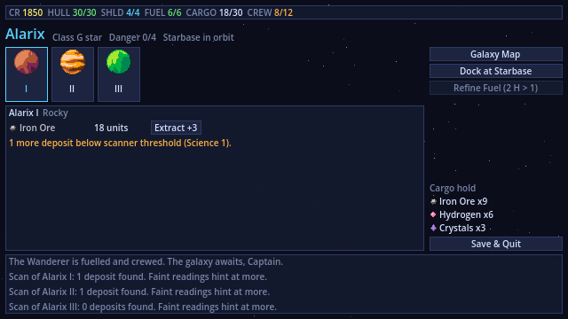

| | |
|---|---|
| 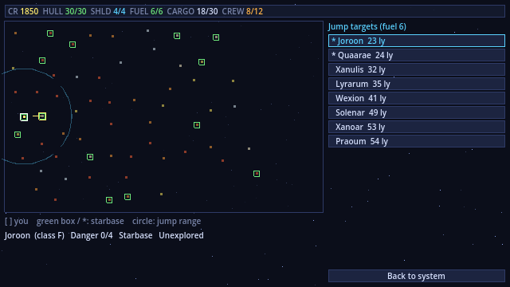 | 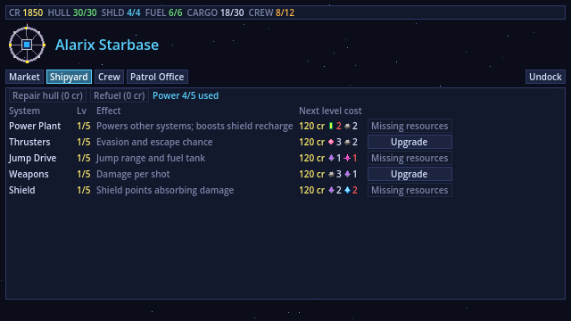 |
| 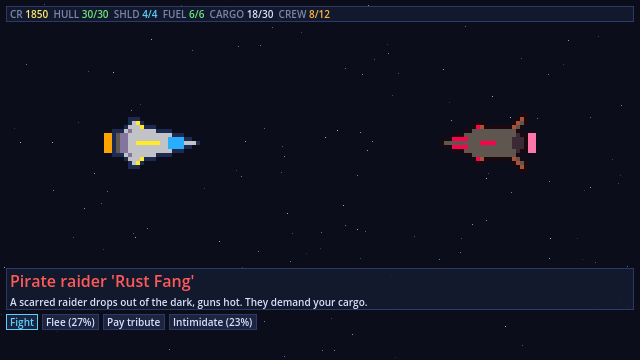 | 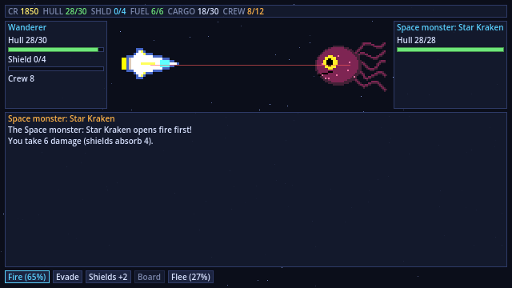 |

---

## Contents

- [Playing](#playing)
- [Rules reference](#rules-reference)
- [Running and building](#running-and-building)
- [Architecture](#architecture)
- [Art](#art)
- [License](#license)

---

## Playing

### Controls

| Action | Keyboard | Gamepad | Mouse |
|---|---|---|---|
| Move between buttons | Arrow keys / Tab | D-pad / left stick | Hover |
| Select | Enter / Space | A (bottom face button) | Click |
| Back / undock | Esc | B (right face button) | – |

These are Godot's built-in `ui_*` input actions, so no extra input mapping is
needed and any controller Godot recognises works.

### The game loop

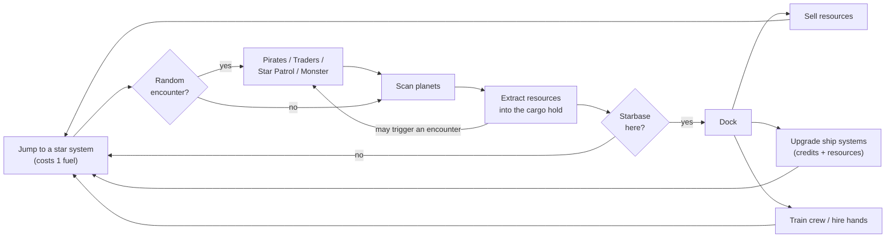

1. **Jump.** Open the Galaxy Map and choose a star inside your jump range.
   Every jump burns one unit of fuel. Starbases are marked with a green box.
2. **Scan.** Your Science Officer surveys a planet. Common deposits show up
   straight away; rarer ones (uranium, crystals, exotic matter) need a better
   science skill. Train the officer and you can come back and rescan.
3. **Extract.** Each extraction run pulls a few units into the hold. Better
   engineers pull more per run. Deposits run out, and mining can attract
   unwanted attention, monsters especially.
4. **Dock and spend.** At a starbase, sell your cargo, buy whatever you are
   short of, repair and refuel, upgrade the ship and train your officers.
5. **Survive.** Encounters can happen on arrival or while mining. The game ends
   if your hull or your crew reaches zero. There is no win screen: see how far
   out you can get and how rich you can grow.

You can't get permanently stuck without fuel. Refine 2 hydrogen into 1 fuel
from the system screen. If you have no hydrogen either, fire a **Distress
Beacon** and the Star Patrol will tow you to the nearest starbase for half your
credits.

The game auto-saves every time you arrive in a system or dock. **Save & Quit**
returns to the title screen, and **Continue** picks up where you left off.

---

## Rules reference

### Ship systems (levels 1–5)

| System | Effect | Upgrade resources (× current level) |
|---|---|---|
| **Power Plant** | Power capacity = 2 + 3 × level. Shield recharge in combat = 1 + level. | 2 Uranium, 2 Iron |
| **Thrusters** | +4% evasion per level, +6% escape chance per level | 3 Hydrogen, 2 Iron |
| **Jump Drive** | Jump range = 45 + 15 × level; fuel tank = 4 + 2 × level | 1 Crystals, 1 Exotic Matter |
| **Weapons** | Damage per hit = 3 × level (+0..Weapons Officer skill) | 3 Iron, 1 Crystals |
| **Shield** | Shield points = 4 × level; they absorb damage before the hull | 2 Crystals, 2 Water Ice |

Every upgrade also costs 120 credits × the current level.

**Power budget:** the levels of Thrusters + Jump Drive + Weapons + Shield
together may not exceed the Power Plant's capacity. A new ship uses 4 of 5, so
the reactor gates every other upgrade path. At most you can max out three of
the four other systems.

### Crew

Six officers each have a skill from 0 to 5. Training costs 150 × (skill + 1)
credits. **Hands** are the rest of the crew: they're your hit points when
boarding, monsters can snatch them, and you can hire more at a starbase (80 cr,
max 12).

| Officer | What the skill does |
|---|---|
| **Captain** | +5% sell price per level; boarding strength; intimidating pirates |
| **Pilot** | +4% evasion and +6% escape chance per level; helps you sneak past monsters |
| **Science Officer** | Detects deposits up to difficulty = skill; sneaking past monsters ("Go dark") |
| **Engineer** | Extraction yield = 2 + skill (− half the deposit difficulty); patches hull after each fight |
| **Doctor** | Each crew casualty has a 12% × skill chance of being saved after battle |
| **Weapons Officer** | +5% hit chance and up to +skill damage per shot; boarding strength |

### Resources

| Resource | Base price | Detect difficulty | Found on |
|---|---|---|---|
| Iron Ore | 12 | 0–1 | Barren, Rocky, Volcanic |
| Water Ice | 9 | 0–1 | Ice, Ocean |
| Hydrogen | 7 | 0–1 | Gas Giant, Ice (refines into fuel) |
| Organics | 16 | 1–2 | Jungle, Ocean, monster carcasses |
| Uranium | 34 | 2–3 | Volcanic, Rocky, Barren |
| Crystals | 42 | 2–3 | Crystalline, Volcanic, Jungle |
| Exotic Matter | 95 | 3–4 | Crystalline, Gas Giant, Ice, monsters |

Starbases buy at base × (0.9 + 0.05 × Captain) and sell at base × 1.3.
Systems further from home are more dangerous (danger 0–4). Their encounters
are tougher and more frequent, but their deposits are just as rich.

### Encounters

| Contact | Options | Notes |
|---|---|---|
| **Pirates** | Fight · Flee · Pay tribute · Intimidate | Tribute costs half of each cargo stack (or credits if the hold is empty). Beating pirates earns a bounty. |
| **Traders** | Trade · Attack · Leave | Trading sells cargo at slightly below starbase prices and buys fuel. Attacking adds +1 notoriety. |
| **Star Patrol** | Clean record: claim bounties · request fuel · leave. Wanted: pay fine · resist · flee | Patrols are more common near starbases and hunt you when your notoriety is high. Attacking one adds +2 notoriety. |
| **Space monsters** | Fight · Flee · Go dark | Can't be boarded. Their attacks may drag off crew. Slain monsters leave organics and sometimes exotic matter. |

A failed Flee, Intimidate or Go-dark roll gives the enemy a free first volley.
Fines (250 cr per notoriety point) and bounties (150 cr per pirate) are handled
by any Patrol cutter or at a starbase's Patrol Office.

### Combat and boarding

Combat is turn-based. Each turn you pick one action, then the enemy responds.

| Action | Effect |
|---|---|
| **Fire** | Hit chance 65% + 5% × Weapons Officer − enemy evasion |
| **Evade** | +20% evasion for the enemy's next attack |
| **Shields** | Recharge shields by 1 + Power Plant level |
| **Board** | Only when the enemy's shields are down and the target isn't a monster |
| **Flee** | 25% + 6% × (Pilot + Thrusters) − 10% × enemy speed |

**Boarding** is a series of crew-versus-crew rounds. Your strength is
hands ÷ 2 + Captain + Weapons Officer ÷ 2 + 1d6. **Charge** adds +2 and kills
two defenders on a win, but costs more when it fails. **Hold** is the safe
option. **Retreat** goes back to ship combat. Capturing a ship gets you all of
its credits and cargo; destroying it leaves only half as salvage.

---

## Running and building

You'll need **Godot 4.7** or newer, the standard build (the .NET build isn't
needed).

```sh
# play from the editor
godot --path . --editor        # then press F5

# or run directly
godot --path .
```

### Tests

The headless test suite covers galaxy generation and connectivity, mining and
depletion, the power budget, combat balance, boarding, encounter rolls, save
round-trips, a smoke pass that builds every screen and checks that a
gamepad can focus it, and a scripted playthrough that presses the real
buttons: mine, dock, sell, buy, upgrade, train, hire, jump, every kind of
encounter, and a fight that ends in a boarding action:

```sh
GODOT=/path/to/godot tools/validate.sh
```

This imports the project, runs `tests/test_runner.tscn` and boots the game,
failing on any script error. Tests use their own save file, so your game is
never touched.

### Rendering this README

`tools/render_readme.sh [html|pdf|all]` writes `build/README.html` and
`build/README.pdf` with the Mermaid diagrams drawn as images. It needs Node.js,
pandoc 3+ and a PDF engine (weasyprint, typst or xelatex). It uses Chromium or
Chrome if one is on your PATH; otherwise it downloads a headless Chrome once,
into `~/.cache/starexplorer-render`. On Arch:
`sudo pacman -S nodejs npm pandoc python-weasyprint unzip`.

### Exporting

Use **Project → Export** in the editor with the official export templates.
Linux, Windows, macOS, Android and Web all work with the Compatibility
renderer. The low resolution and controller-first UI also suit handhelds such
as the Steam Deck. Console exports, Nintendo Switch included, aren't in
Godot's open-source templates: they need a licensed developer account and a
third-party porting service.

---

## Architecture

All gameplay rules live in plain `RefCounted` classes with no UI code, so the
test suite can run them headless. A single autoload, `Game`, owns the session
state and exposes one method per player action. Screens are thin: they read
from `Game`, call its methods, and redraw. There are almost no `.tscn` files.
Every screen builds its UI in code from the small helpers in `UIKit`, so a
layout is defined in exactly one place.

### Directory layout

```
starexplorer/
├── project.godot            640x360, integer scaling, Compatibility renderer
├── scenes/main.tscn         the only gameplay scene: a Control running main.gd
├── scripts/
│   ├── main.gd              screen router + starfield background
│   ├── autoload/game.gd     "Game" singleton: state, actions, save/load
│   ├── core/                pure rules, no UI
│   │   ├── galaxy.gd        seeded star map, depletion & scan records
│   │   ├── star_system.gd   seeded planets and deposits per star
│   │   ├── planet.gd        planet types and their deposits
│   │   ├── resource_db.gd   resource names, prices, detection difficulty
│   │   ├── cargo_hold.gd    capacity-limited resource bag
│   │   ├── ship.gd          systems, power budget, upgrades
│   │   ├── crew.gd          officer skills and hands
│   │   ├── encounter.gd     encounter generation and enemy stats
│   │   └── combat_engine.gd turn-based combat and boarding
│   ├── ui/                  reusable UI pieces
│   │   ├── ui_kit.gd        palette, theme, widget factories
│   │   ├── screen.gd        base class for all screens
│   │   ├── status_bar.gd    credits/hull/shield/fuel/cargo/crew HUD
│   │   └── starfield.gd     animated background
│   └── screens/             one script per screen
│       ├── title_screen.gd, system_screen.gd, galaxy_screen.gd,
│       ├── starbase_screen.gd, encounter_screen.gd,
│       └── combat_screen.gd, game_over_screen.gd
├── assets/sprites/          generated pixel art (PNG)
├── tools/
│   ├── gen_art.py           regenerates every sprite (Pillow)
│   ├── validate.sh          import + tests + boot check
│   └── screenshots.gd/.tscn renders docs/screenshots
├── tests/test_runner.gd/.tscn
└── docs/screenshots/
```

### Layers

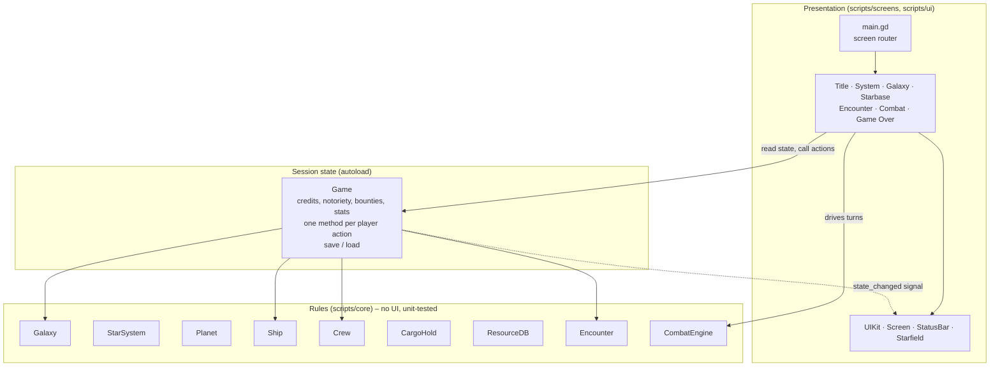

### Core classes

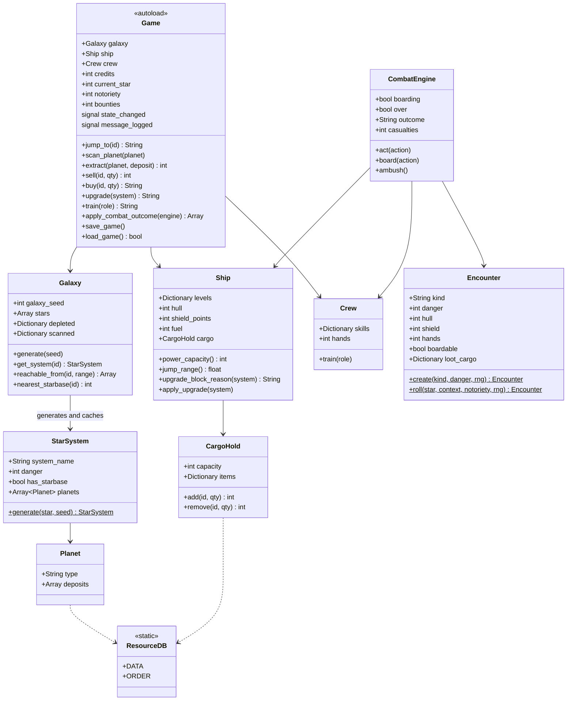

### Screen flow

`main.gd` keeps exactly one `Screen` alive. A screen asks to move by emitting
`navigate(screen_name, params)`, and Main frees it and builds the next one.
Screens never hold references to each other.

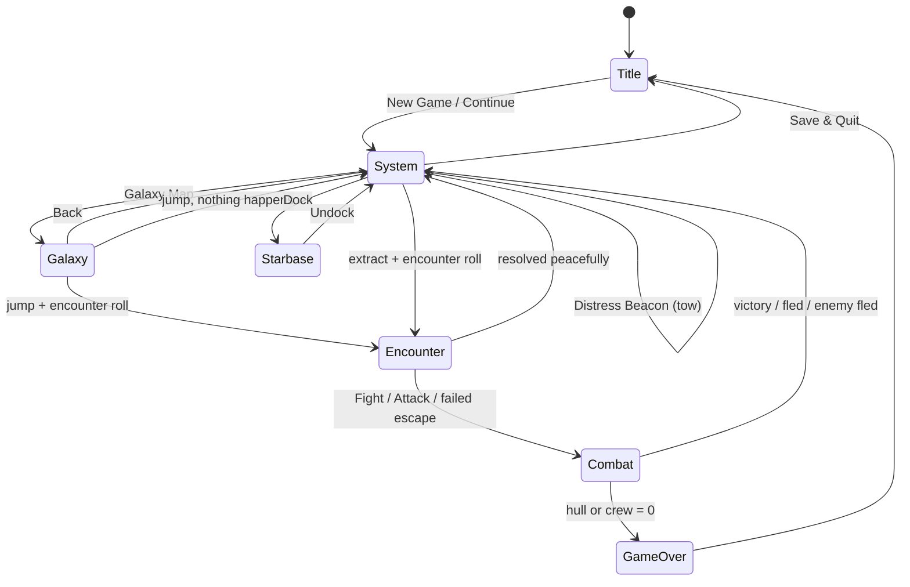

### A combat turn

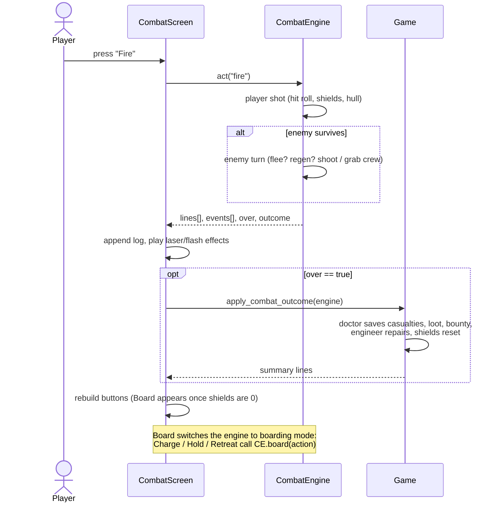

### Determinism and saving

The galaxy is generated from a single integer seed. Stars come from
`Galaxy.generate(seed)`, and each system's planets come from
`StarSystem.generate(star, seed)`, seeded with `hash([seed, star_id])`, so a
system is only built when you first look at it and is identical every time.
Galaxy generation grows outward from the home star, placing each new star
within `LINK_MAX` of an existing one. That makes every system reachable with a
level-1 jump drive (the tests check this for several seeds).

The save file is a small JSON document holding the seed plus the few things
that change: deposits already mined (`"star:planet:deposit" → units`), scan
levels, ship, crew, credits and progress.

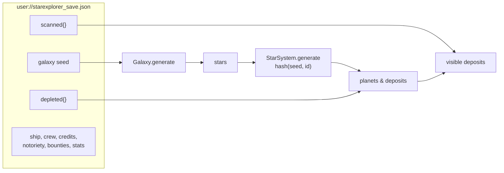

### Adding content

- **A resource:** add it to `ResourceDB.DATA` and `ORDER`, give it weights in
  `Planet.TYPES`, and draw an icon in `tools/gen_art.py`.
- **A planet type:** add an entry to `Planet.TYPES` and `TYPE_WEIGHTS` and a
  palette to `PLANETS` in `gen_art.py`.
- **An encounter kind:** add a branch to `Encounter.create` and its weight to
  `Encounter.roll`, then its choices to `encounter_screen.gd`.
- **A screen:** extend `Screen`, override `enter()` (and `back()`), and
  register it in `main.gd`'s `SCREENS`.

---

## Art

Every sprite in `assets/sprites/` is generated by `tools/gen_art.py`. Ships
are ASCII pixel maps, and planets, the starbase and the monster are drawn
procedurally from fixed seeds. To change the art, edit the script and run:

```sh
python3 tools/gen_art.py   # needs Pillow
```

The palette is mostly the PICO-8 colours. Textures use nearest-neighbour
filtering and 2D transforms snap to whole pixels, so everything stays crisp at
any integer scale.

---

## License

StarExplorer is free software: you can redistribute it and/or modify it under
the terms of the **GNU General Public License, version 3**, as published by the
Free Software Foundation. See [LICENSE](LICENSE) for the full text.

This covers the source code and the generated art (and the script that
generates it). Godot Engine itself is MIT-licensed, which is compatible.

This program is distributed in the hope that it will be useful, but WITHOUT ANY
WARRANTY; without even the implied warranty of MERCHANTABILITY or FITNESS FOR A
PARTICULAR PURPOSE.
